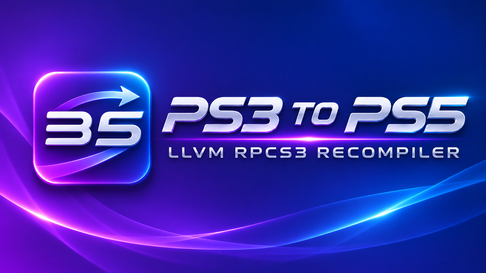

# PS3 TO PS5 LLVM RPCS3 RECOMPILER



PS3 TO PS5 LLVM RPCS3 RECOMPILER boots a local PS3 disc dump directly with a PS5 build of the RPCS3 runtime. It uses LLVM for PPU and SPU code and the native Vulkan backend for RSX graphics. The profile keeps RPCS3's default GPU settings, including resolution scale, frame limit and VBlank. Vulkan and the PS5 audio backend are selected for the target.

The Vulkan changes include the interpreter's base pipeline catalogue, parallel preparation, shared driver caching, device-checked dynamic states, depth and feedback passes, and retry of pending texture uploads. LLVM and Vulkan caches are built locally and reused on later launches. A new game or driver can still require compilation. Compatibility and timing depend on the game and need to be tested on the target.

## Prepare a disc

Use a directory containing `PS3_DISC.SFB`, `PS3_GAME/PARAM.SFO`, and `PS3_GAME/USRDIR/EBOOT.BIN`. Keep the original title ID and the full disc structure. RPCS3's guide describes supported dump formats and local firmware installation. [RPCS3 Quickstart](https://rpcs3.net/quickstart)

```sh
python tools/prepare_dump.py inspect /path/to/disc-dump
python tools/prepare_dump.py stage \
  --disc /path/to/disc-dump \
  --firmware /path/to/dev_flash \
  --core /path/to/packaged/eboot.bin \
  --param /path/to/homebrew/sce_sys/param.json \
  --output local/DiscA
```

Use a `param.json` from the local package for the target PS5 homebrew title and its matching platform modules. The tool sets the display name to **PS3 TO PS5 LLVM RPCS3 RECOMPILER** in each locale and preserves the package identifiers. `templates/param.json` shows the name fields with placeholder IDs. Keep platform modules supplied by the native build in `sce_module/` when needed. Run the resulting directory with your PS5 homebrew environment.

The package uses the RPCS3 icon by default. Pass `--icon0 path/to/icon.png` to replace the icon and `--pic0 path/to/background.png` to add a background. These options only change the local output directory.

## Display, controller and SPU options

- Add `--display-mode 120hz` to request high-refresh output, or `--display-mode 120hz-vrr` to also opt in to variable refresh. The staging tool sets the matching `param.json` flags and a 120 FPS limit in the local profile. A compatible title, PS5 output setting and display are required. VideoOut reports the selected mode in `RECOMPILER_DISPLAY_MODE`, and `RECOMPILER_CADENCE` counts guest presents separately from overlays. The target can fall back to standard refresh if the higher mode is unavailable. Game frame rates depend on the title and workload.
- The native pad handler enables DualSense accelerometer and gyro input and maps the samples to PS3 Sixaxis channels. Guest support determines when the sensors and rumble are used.
- Add `--spu-hybrid` to keep LLVM SPU preparation and allow AsmJit to handle live SPU cache misses. The persistent caches remain local. Shader warmup prepares known Vulkan pipeline variants in parallel within a bounded queue. Scenes with previously unseen shader states can still need runtime compilation.

The standard GPU profile is the default. To select a separate display or graphics profile explicitly, place `ps5-pro.enable` alongside `rpcs3-recompiler-pro.yml` in the title folder. This is a manual choice. Use the same frame-limit and display metadata settings if you want the same refresh behavior in both profiles.

## Install an update or DLC

1. In desktop RPCS3, install your update or DLC package for the disc's exact PS3 title ID and region using **File → Install Packages/Raps/Edats**. Install content you own with the associated license if required by RPCS3.
2. Use desktop RPCS3 to check that the installed title works. Keep the disc dump intact. The installed title folder is under `dev_hdd0/game/<PS3 title ID>`. Copy that folder to the corresponding location in the private native data directory, by default `/data/rpcs3-recompiler/dev_hdd0/game/<PS3 title ID>`.
3. If the DLC requires a local entitlement, use the matching private `dev_hdd0/home/<user>/exdata` directory. The default profile uses user `00000001`. Keep the package files, game data and licenses local.
4. Launch the disc. RPCS3 detects an update using the matching title ID and the installed update's `PARAM.SFO` and `USRDIR/EBOOT.BIN`. The guest game looks up DLC in its installed data.

Cache and logs are kept under `/data/rpcs3-recompiler`. Keep the cache between runs to reuse work. The exact shader states, scene data, patches and DLC manifests for individual games belong to local title profiles.

### Optional single-file disc update

Use a clean desktop RPCS3 installation of the matching update as input. The tool packs every update file, including empty files, into a short-named archive and creates a private C++ manifest for that build.

```sh
python tools/pack_update.py --disc /path/to/disc-dump \
  --update /path/to/dev_hdd0/game/TITLEID --output local/title-update
python tools/apply_overlay.py rpcs3 \
  --update-manifest local/title-update/recompiler_title_update_manifest.h
```

Build from that checkout. Place `UPDATE.BIN` beside the resulting `eboot.bin` and `PS3_GAME` in the staged title. The launcher checks the disc ID, archive SHA-256 and each file before publishing the update to private game data. For a new guest executable, LLVM may compile new PPU modules on the first launch. Check `RECOMPILER_TITLE_UPDATE`, `Updates found`, and `APP_VER` in the runtime log to confirm the update was selected. The manifest and archive contain local title data and are ignored by Git.

## Build

This repository contains source changes for the native runtime. Build the target dependencies first using their pinned revisions in [graphics-dependencies.json](graphics-dependencies.json). The PS5 configuration expects a native LLVM toolchain, Qt, FFmpeg, Vulkan/RADV, and their PS5 paths. The options and expected paths are recorded in the platform patch and checked by CMake.

Apply [the VideoOut patch](patches/mesa-videoout.patch) to the pinned PS5 Mesa checkout before building the RADV release archive. The patch includes display ownership handoff and handles the idle period of a VRR display before the first flip. Commit the patch locally because the PS5 Vulkan driver builder reads the Mesa sources from a Git revision. With `PS5_Mesa` next to `PS5_Vulkan`, run the following commands after configuring the upstream build prerequisites. [PS5 Vulkan RADV build](https://github.com/mihawk-99/PS5_Vulkan/blob/ace98a99460c95a8d2821a9e33935c7b71070f7f/tools/build-radv.sh)

```sh
git -C PS5_Mesa checkout 1ba9874f478657ccf6da72ce55f0260164cc0bd0
git -C PS5_Mesa apply /path/to/recompiler/patches/mesa-videoout.patch
git -C PS5_Mesa add src/vulkan/wsi/wsi_common_videoout.c src/vulkan/wsi/videoout_refresh_policy.h
git -C PS5_Mesa commit -m "Apply native VideoOut integration"
PS5_MESA_REVISION="$(git -C PS5_Mesa rev-parse HEAD)" \
  bash PS5_Vulkan/tools/build-radv.sh release
```

Point `RPCS3_PS5_RADV_ROOT` at the resulting `PS5_Vulkan/.deps/native/radv-release` directory for the native build.

For the native LLVM build, use [PS5_LLVM](https://github.com/lavavex/PS5_LLVM/tree/be5b58f51c93c67947b7e18cd45c2f9913f2c311). Copy `llvm-overlay/llvm/lib/ExecutionEngine/TargetSelect.cpp` to the same relative path in that checkout before building its libraries. The launcher and its linked LLVM target selector use the same native tracing symbols.

```sh
git clone https://github.com/RPCS3/rpcs3.git rpcs3
git -C rpcs3 checkout ca3e5b268efae904eb9c4c2c97fd62aac980d377
git -C rpcs3 submodule update --init --recursive
python tools/apply_overlay.py rpcs3
cmake -S rpcs3 -B build/ps5 -G Ninja \
  -DCMAKE_TOOLCHAIN_FILE="$PWD/rpcs3/ps5/toolchain.cmake" \
  -DRPCS3_RECOMPILER=ON \
  -DCMAKE_BUILD_TYPE=Release \
  -C /path/to/native-dependencies.cmake
cmake --build build/ps5 --target rpcs3
```

Pass the native ELF to the application packaging tools provided by your target environment. Use the resulting `eboot.bin` with the staging command above.

## Credits

- The **RPCS3 team and contributors** developed the emulator core, the PPU and SPU recompilers, the RSX implementation, and the Vulkan shader interpreter. The default app icon uses the RPCS3 logo. [RPCS3](https://github.com/RPCS3/rpcs3) · [Contributors](https://github.com/RPCS3/rpcs3/graphs/contributors)
- The **LLVM Project contributors** developed the compiler backend. The native build uses the PS5 LLVM port maintained by **lavavex**. [LLVM](https://llvm.org/) · [PS5 LLVM](https://github.com/lavavex/PS5_LLVM)
- The **Mesa contributors** developed the RADV driver. **mihawk-99** and the contributors to PS5 Vulkan and PS5 Mesa provide the native graphics integration. [Mesa](https://www.mesa3d.org/) · [PS5 Vulkan](https://github.com/mihawk-99/PS5_Vulkan) · [PS5 Mesa](https://github.com/mihawk-99/PS5_Mesa)
- **The Khronos Group** maintains the Vulkan headers. **Arseny Kapoulkine** and contributors maintain volk, the Vulkan loader helper. [Vulkan Headers](https://github.com/KhronosGroup/Vulkan-Headers) · [volk](https://github.com/zeux/volk)
- The **PS5 Payload SDK**, **Qt**, and **FFmpeg** contributors provide tooling, the application framework, and media support. [PS5 Payload SDK](https://github.com/ps5-payload-dev/sdk) · [Qt](https://www.qt.io/) · [FFmpeg](https://ffmpeg.org/)

RPCS3 source keeps its upstream license and notices. The dependency revisions and license texts are listed in [THIRD_PARTY.md](THIRD_PARTY.md) and [licenses](licenses).
